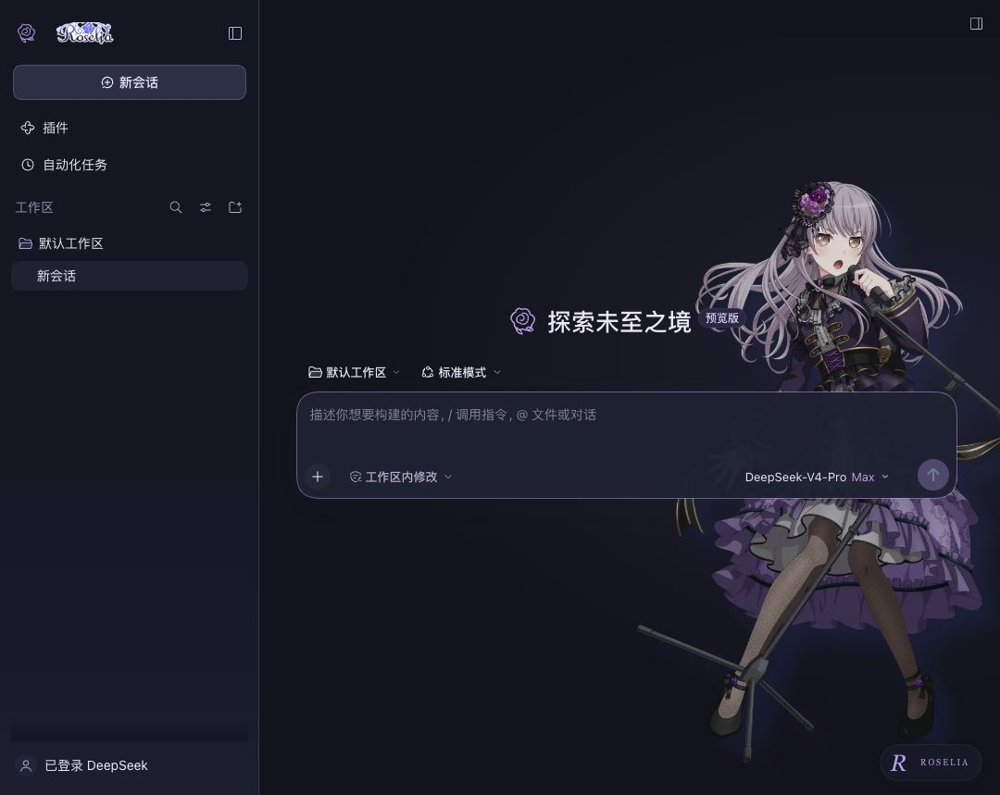
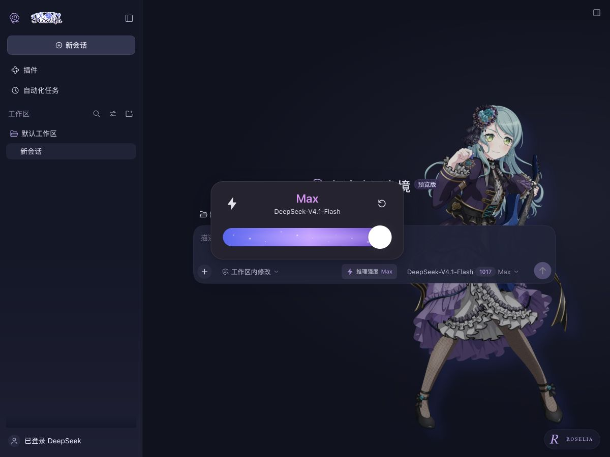

# Roselia · Nocturne / 夜曲

为 **BanG Dream! Roselia** 制作的 DSH 全局界面主题。**0.2.0 默认以官方成员立绘为主角**：每次进入首页，随机遇见五位成员之一。深色采用午夜蓝、紫水晶与银白，浅色采用淡紫与月光白；保留官方标志与演出主视觉，并增加与模型菜单同步、点击后展开的推理强度浮层。





## 使用效果

- 全局语义配色覆盖侧栏、对话区、输入框、代码块及交互状态，明暗模式跟随 DSH。
- 右下角 **ROSELIA / R** 打开主题面板：成员舞台、夜曲、演出、纯净四种场景；随机成员、全员或固定成员；氛围强度；成员装饰开关。
- 默认是成员舞台、随机相遇、75% 强度。每次进入首页或切到新的空白会话时重新抽取，不连续重复；普通重渲染和调节强度不会换人。固定成员模式保持选择。
- 偏好保存在当前浏览器的本地存储；上一位随机成员保存在当前标签页的 sessionStorage，刷新后也避免连续重复。旧版完全默认的设置会迁移为新设计，明确选过的固定成员或其他场景保留。
- 对话中的装饰自动减淡；背景不拦截点击。纯净模式只保留配色与品牌标志。
- 图片全部随客户端打包，使用时不请求图片网站。面板的官方链接仅在点击时打开。
- 保留 DSH 的字体、字号、明暗设置与业务操作；停用插件时撤销主题覆盖、品牌插槽和界面元素。

这是个人非官方主题。素材出处见 [ATTRIBUTION.md](ATTRIBUTION.md)。

## 推理强度滑动条

检查当前 DSH 的官方 `ui-model-selection` 实现后，确认它提供选项菜单，没有内置滑动模式或可开启的 slider 配置。本插件通过官方 **`conversation.input.right` 插槽**增加紧凑入口，点击“推理强度”才展开滑动浮层，并使用 **`ctx.modelDirectories`** 与原模型菜单共享目录、选择状态和提交接口。

浮层参考 Codex 的推理强度交互：顶部显示当前档位和模型名，底部采用宽幅蓝紫渐变轨道、流动光点与白色圆形滑块。关闭时不占据主页或输入框上方空间。拖动时预览，释放时提交；方向键、Home/End 也可操作；Escape 或点击外部关闭浮层。恢复按钮回到当前模型声明的默认档位。它仅显示当前模型由适配器公布的档位，不构造不支持的中间值。选择从下一次请求生效，原模型菜单继续可用。

没有推理元数据、不可路由或已寻址的子智能体会话不显示滑条。等待保存时阻止重复提交，失败时显示原因并保留官方真实选择；支持减少动态效果和系统强制颜色。滑条不会自动改变当前推理强度，也不会发起模型请求。

## 兼容范围

目前声明并验证 **DSH 0.2.1-rc.2**，Node.js 22 及以上。真实浏览器验证基于该版本的 Web Client；DSH Desktop 复用此客户端，但尚未在 Electron 应用中实测。其他版本需要重新核对接口后再扩大 `engines.dsh`，不要直接删除版本限制。

## 构建与只读预览

所有命令都在插件目录执行；安装开发依赖和构建不需要修改旁边的 DSH 仓库。

```sh
git clone https://github.com/fansunjia-glitch/dsh-display-roselia.git
cd dsh-display-roselia
npm ci
npm run build
npm run preview -- --dsh /path/to/dsh --port 0
```

预览入口只在 macOS 工作，强制使用系统 `sandbox-exec` 拒绝向官方仓库及其他目录写入。它使用 DSH 已有的 `apps/cli/lib/bin.js` 和 `apps/web/dist/index.html`，缺失时退出，不代为构建官方项目。

终端会显示本机访问地址。首次访问使用终端提供的带登录 token 的 URL；不要分享此 URL。数据、配置、缓存全部位于本插件的 `.preview/` 和 `.preview-home/`，与日常 DSH profile 隔离。预览只监听 `127.0.0.1`，按 `Ctrl+C` 停止。未配置模型账号时可以关闭“开始使用”提示，查看和调整主题。

## 安装进自己的 DSH

从 [GitHub Releases](https://github.com/fansunjia-glitch/dsh-display-roselia/releases) 下载预构建的 `dsh-display-roselia-0.2.0.tgz`，或按上面的命令克隆并构建源码。

对于普通 CLI / Web / PWA，使用管理该实例的 `dsh` CLI，将下面的 `你的profile名称` 替换为实际名称：

```sh
dsh plugin --profile 你的profile名称 add /absolute/path/to/dsh-display-roselia
dsh --profile 你的profile名称
```

这是官方支持的本地目录链接安装：后续仍在 `display/` 修改源码，执行 `npm run build`，再刷新客户端；改动 manifest 或 bundle patch 后需重启 DSH。已有实例按其原有方式重启，避免同一 profile 重复运行。

若使用真正的 **Electron Desktop 应用**，应先启动一次应用完成初始化，再完全退出，使用 **Desktop 自带的 CLI** 对 `--profile desktop` 执行安装；普通 npm CLI 不能修改 Desktop 受管 profile。不要把浏览器 PWA 与 Electron Desktop 混为一谈。

推荐直接安装 Release 中预构建的 tarball，无需授权运行安装构建脚本：

```sh
dsh plugin --profile 你的profile名称 add /absolute/path/to/dsh-display-roselia-0.2.0.tgz
```

源码开发请使用克隆后本地目录链接的流程。退出 DSH 后移除：

```sh
dsh plugin --profile 你的profile名称 remove dsh-display-roselia
```

重新启动后恢复官方外观。插件的本地偏好会保留，以便重新安装时继续使用；面板内的“恢复默认”可重置偏好。

## 开发导航

| 文件 | 职责 |
| --- | --- |
| `src/client/palette.ts` | 明暗两套 DSH 语义色值 |
| `src/client/theme.css` | 场景、品牌、主题面板与窄窗口样式 |
| `src/client/artwork.ts` | 官方图片与成员索引 |
| `src/client/controls.ts` | 设置面板、键盘操作与本地偏好 |
| `src/client/member-stage.ts` | 官方主页插槽生命周期中的随机成员与防重复逻辑 |
| `src/client/reasoning.tsx` | 官方模型目录上的离散滑动控件与提交状态 |
| `src/client/reasoning.css` | 浮层、流光轨道、响应式及无障碍视觉 |
| `src/client/index.ts` | `theme` / `slots` 接入及生命周期清理 |
| `scripts/build.mjs` | 独立构建 Host ESM 与 DSH 浏览器 factory |
| `scripts/preview.mjs` | macOS 隔离只读预览 |
| `cordis.patch.yml` | 独立 bundle 插件行 |

浏览器构建产物遵循 DSH 的 `window.__ModuleLoader__.load` factory 协议；不能替换成普通 ESM 文件。React JSX 运行时由 DSH 提供，避免重复打包框架实例。大幅 PNG 背景使用 Blob URL，绕开 Chromium 对过大的 CSS 自定义属性值的限制；卸载时释放。

随机成员通过官方 `conversation.hero.brand.mark` 插槽的挂载和卸载识别主页，且只监听该主会话容器公开的 `data-content-phase`、`data-conversation-session` 属性。不会扫描对话文本或读取 React 私有状态。

```sh
npm run typecheck
npm test
mkdir -p release
npm pack --pack-destination release
```

验证范围与截图见 [VERIFICATION.md](VERIFICATION.md)。开发原则：**独立构建插件，官方 DSH 仓库只读；通过官方 bundle、profile、主题服务和插槽接入。**

## 发布流程

仓库的 `Release plugin` 工作流可在 Actions 中手动选择已有版本标签运行；后续推送 `v*` 标签也会触发。它从标签检出源码，执行类型检查、测试与打包，再将预构建 `.tgz` 和 `SHA256SUMS` 上传到对应 GitHub Release。运行不依赖本机 DSH checkout，也不需要个人访问令牌。
